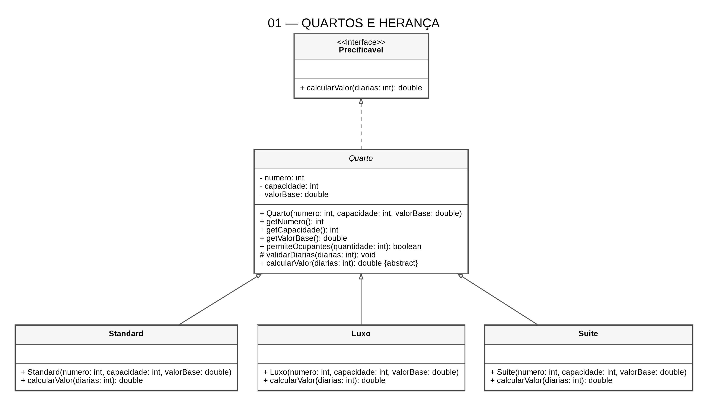
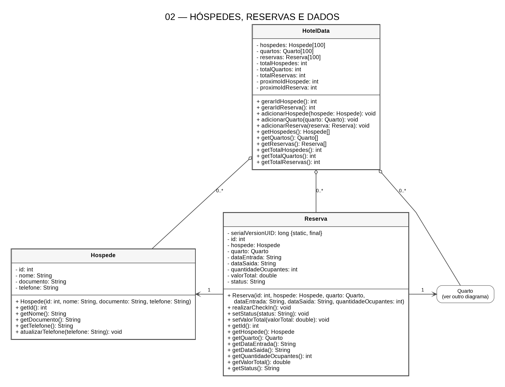
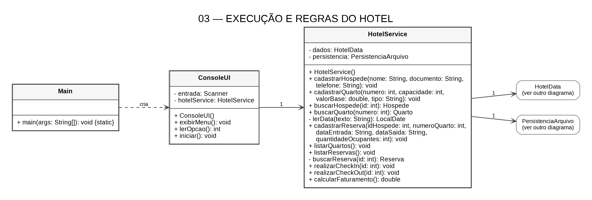
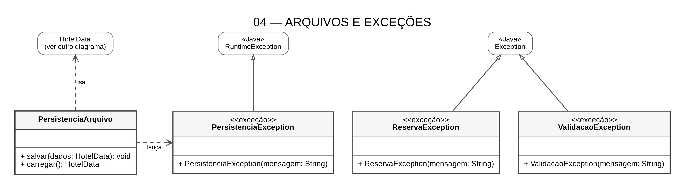

# 🏨 HotelStay — Sistema de Gerenciamento de Reservas

**Projeto final da disciplina de Programação Orientada a Objetos (C06) — Inatel, 2026**  
**Professor:** Christopher Lima  
**Integrantes:** Nathan Arruola da Costa e Gustavo Giron

## 📖 Sobre o projeto

O **HotelStay** é uma aplicação desenvolvida em **Java**, executada pelo console, que simula operações básicas de um hotel. O sistema permite cadastrar hóspedes, consultar quartos, realizar reservas, registrar check-in e check-out, calcular valores de hospedagem e consultar o faturamento.

O objetivo acadêmico é aplicar os principais conceitos de **Programação Orientada a Objetos (POO)** em uma solução organizada, com regras de negócio, tratamento de exceções e persistência de informações em arquivos.

## ⚙️ Funcionalidades

- Cadastro de hóspedes com identificação, documento e telefone.
- Consulta dos quartos cadastrados, separados em **Standard, Luxo e Suíte**.
- Cadastro e listagem de reservas com hóspede, quarto, período e quantidade de ocupantes.
- Cálculo automático da quantidade de diárias e do valor da hospedagem.
- Validação de datas, capacidade dos quartos e conflitos de reservas no mesmo período.
- Registro de **check-in** e **check-out**, com controle do estado da reserva.
- Consulta do faturamento correspondente às reservas finalizadas.
- Salvamento e recuperação dos dados entre execuções do programa.

*Na primeira execução sem dados salvos, o sistema cadastra automaticamente hóspedes e quartos de exemplo para facilitar os testes.*

## 💻 Tecnologias utilizadas

- **Java 17 ou superior**.
- **IntelliJ IDEA && VSCODE IDEA** como ambiente de desenvolvimento.
- **Console** para interação com o usuário.
- **Arrays** para armazenar hóspedes, quartos e reservas em memória.
- **`java.io`** (`Serializable`, `ObjectOutputStream` e `ObjectInputStream`) para persistência em arquivo.
- **`java.time`** para validação de datas e cálculo das diárias.
- **Git e GitHub** para versionamento e colaboração.

O projeto não utiliza bibliotecas externas, banco de dados ou threads. A persistência é feita por arquivos, conforme uma das alternativas previstas no enunciado.

## 🗂️ Organização do código

```text
src/
├── Main.java
└── br/inatel/cdg/
    ├── Exception/
    │   ├── ReservaException.java
    │   └── ValidacaoException.java
    ├── hospede/
    │   └── Hospede.java
    ├── persistencia/
    │   ├── HotelData.java
    │   ├── PersistenciaArquivo.java
    │   └── PersistenciaException.java
    ├── quarto/
    │   ├── Precificavel.java
    │   ├── Quarto.java
    │   ├── Standard.java
    │   ├── Luxo.java
    │   └── Suite.java
    ├── reserva/
    │   └── Reserva.java
    ├── service/
    │   └── HotelService.java
    └── ui/
        └── ConsoleUI.java
```

A classe **`Main`** inicia o programa; **`ConsoleUI`** apresenta o menu; **`HotelService`** reúne as operações do hotel; as classes de modelo representam hóspedes, quartos e reservas; e as classes de persistência cuidam do armazenamento dos dados.

## 🧩 Conceitos de POO aplicados

| Conceito | Aplicação no HotelStay |
|---|---|
| **Classes e objetos** | `Hospede`, `Reserva`, `HotelService`, entre outras. |
| **Encapsulamento** | Atributos privados e acesso por métodos públicos. |
| **Herança** | `Standard`, `Luxo` e `Suite` herdam de `Quarto`. |
| **Polimorfismo** | Cada tipo de quarto implementa `calcularValor(int diarias)` com sua regra de preço. |
| **Classe abstrata** | `Quarto` define atributos e comportamentos compartilhados. |
| **Interface** | `Precificavel` define o contrato do cálculo de valores. |
| **Tratamento de exceções** | `ReservaException`, `ValidacaoException` e `PersistenciaException`. |
| **Persistência** | `HotelData` é salvo e recuperado pelo `PersistenciaArquivo`. |

**Opções do menu:**

```text
===== HOTELSTAY =====
1 - Cadastrar reserva
2 - Listar reservas
3 - Realizar check-in
4 - Realizar check-out
5 - Consultar faturamento
6 - Cadastrar hospede
7 - Listar quartos
0 - Sair
```

Ao criar uma reserva, informe as datas no formato **`dd/MM/aaaa`** (por exemplo, `20/11/2026`). O sistema calcula as diárias automaticamente. As reservas só podem ser feitas para quartos cadastrados e períodos disponíveis.

## 💾 Armazenamento dos dados

Os cadastros e as reservas são mantidos em memória por `HotelData` e gravados no arquivo **`hotel.dat`** por `PersistenciaArquivo`. Quando o programa é iniciado novamente, o arquivo é lido para recuperar as informações anteriores.

Essa abordagem atende ao requisito de **leitura e escrita de arquivos**, sem a necessidade de banco de dados. O arquivo `.dat` é um arquivo binário de objetos Java e não foi projetado para edição manual.


## 📐 Diagrama UML

Os diagramas abaixo representam as classes, atributos,
métodos e relacionamentos do sistema HotelStay.

### 1. Quartos, Herança e Interface



### 2. Hóspedes, Reservas e HotelData



### 3. Main, ConsoleUI e HotelService



### 4. Persistência e Exceções



## 🤖 Declaração de uso de Inteligência Artificial

**O grupo utilizou inteligência artificial?** Sim.

**Ferramenta utilizada:** **ChatGPT, da OpenAI**.

O ChatGPT foi utilizado como ferramenta de apoio durante o planejamento, desenvolvimento, revisão e documentação do **HotelStay**, nas seguintes atividades:

- Organização da estrutura do projeto, dos pacotes e das responsabilidades das classes.
- Esclarecimento de dúvidas sobre **classes abstratas, interfaces, herança, polimorfismo, encapsulamento e exceções**.
- Sugestão e geração de trechos de código para funcionalidades como cadastro de hóspedes e quartos, reservas, cálculo de diárias, check-in, check-out e persistência em arquivos.
- Apoio na simplificação e refatoração de classes, especialmente na revisão do `HotelService` e da `Reserva`.
- Auxílio na identificação de erros, análise de compatibilidade entre as classes e definição de cenários de teste.
- Apoio na elaboração e revisão do **diagrama UML** e deste **README**.

As sugestões e os trechos gerados com auxílio da ferramenta foram selecionados, revisados, adaptados e integrados ao projeto pelos integrantes, que ficaram responsáveis por testar, compreender e apresentar a solução desenvolvida.

---

**HotelStay — Projeto acadêmico de Programação Orientada a Objetos | Inatel — 2026.**
